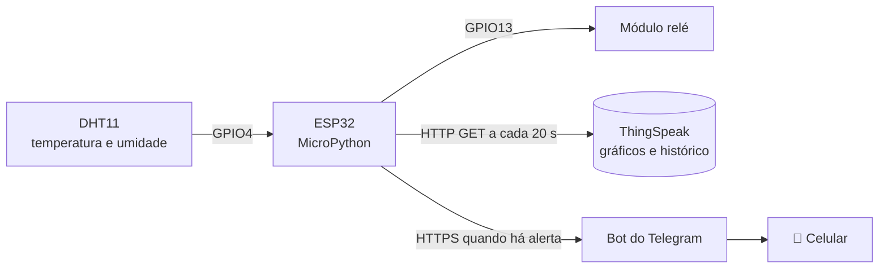

<div align="center">

# 🌡️ Monitor de Temperatura e Umidade com ESP32

**Sistema IoT que lê temperatura e umidade, aciona um relé automaticamente, registra os dados na nuvem e avisa no celular quando algo foge do normal.**


[▶️ Ver demonstração em vídeo](https://www.youtube.com/shorts/b2PxfBjYRP4)

</div>

---

## 📌 Sobre o projeto

Projeto desenvolvido como trabalho acadêmico e documentado aqui como estudo de **IoT conectado à nuvem**. O ESP32 faz a leitura do sensor DHT11, decide se deve acionar o relé com base em limites configuráveis e envia os dados para duas plataformas externas:

- **ThingSpeak**: histórico e gráficos de temperatura e umidade
- **Telegram**: alerta em tempo real no celular

### Regra de negócio

| Condição | Ação do relé | Alerta no Telegram |
|---|---|---|
| Temperatura **> 31 °C** **ou** Umidade **> 70 %** | **Liga** | Enviado (uma única vez por ocorrência) |
| Nenhuma das duas | **Desliga** | Reinicia o controle de alertas |

Basta **uma** das condições ser verdadeira para o relé ligar.

---

## 🏗️ Arquitetura



---

## 🔌 Hardware

| Componente | Quantidade |
|---|---|
| ESP32 DevKit (ESP32-D0WD-V3) | 1 |
| Módulo sensor DHT11 (com resistor de pull-up embutido) | 1 |
| Módulo relé 1 canal (3 pinos) | 1 |
| Jumpers e cabo micro-USB | - |

### Ligações

| Componente | Pino do módulo | ESP32 |
|---|---|---|
| DHT11 | VCC (+) | 3V3 |
| DHT11 | GND (-) | GND |
| DHT11 | DATA (OUT) | **GPIO4** |
| Relé | GND (-) | GND |
| Relé | VCC (+) | VIN |
| Relé | Sinal (S) | **GPIO13** |

> 💡 O relé está em **GPIO13** de propósito: o GPIO2 é um *strapping pin* (influencia o boot do ESP32) e deve ser evitado para periféricos externos.

<!-- Adicione aqui uma foto da montagem:

-->

---

## 🛠️ Ambiente de desenvolvimento

- **IDE:** Thonny
- **Sistema:** Ubuntu rodando em VirtualBox (Windows como host)
- **Firmware:** MicroPython v1.29.0 (build genérico ESP32)
- **Biblioteca extra:** `urequests` (instalada com `mip`)

---

## 🚀 Como rodar

### 1. Clone o repositório
```bash
git clone https://github.com/SEU_USUARIO/iot-monitor-esp32.git
cd iot-monitor-esp32
```

### 2. Crie o canal no ThingSpeak
Crie um canal com **Field 1 = Temperatura** e **Field 2 = Umidade** e copie a *Write API Key*.

### 3. Crie o bot no Telegram
Use o **@BotFather** (`/newbot`) para obter o token e o **@userinfobot** para descobrir seu `chat_id`. Depois envie qualquer mensagem ao seu bot para ativar a conversa.

### 4. Configure as credenciais
```bash
cp src/secrets.example.py src/secrets.py
```
Edite `src/secrets.py` com seus dados reais. **Esse arquivo está no `.gitignore` e nunca deve ser enviado ao GitHub.**

### 5. Instale a biblioteca `urequests` no ESP32
No Shell do Thonny, com o ESP32 conectado ao WiFi:
```python
import mip
mip.install('urequests')
```

### 6. Grave os arquivos na placa
No Thonny, abra `src/main.py` e `src/secrets.py` e use **Arquivo → Salvar como → MicroPython device** para cada um. Depois execute `main.py` (F5).

### Saída esperada no Shell
```
A ligar a rede wifi...
Conectado com sucesso
Temperatura: 28C  |  Umidade: 40%
Rele DESLIGADO
Enviado ao ThingSpeak: 1
```

---

## 🧪 Scripts de teste

A pasta `tests/` tem scripts para validar cada parte isoladamente. Foram úteis durante o desenvolvimento para localizar problemas:

| Script | O que testa |
|---|---|
| `teste_wifi_scan.py` | Se o rádio WiFi enxerga redes |
| `teste_dht11.py` | Leitura do sensor |
| `teste_rele.py` | Fiação e lógica do relé |
| `teste_thingspeak.py` | Envio de dados ao ThingSpeak |
| `teste_telegram.py` | Envio de mensagem pelo bot |

---

## 🧯 Problemas encontrados e soluções

Registro dos problemas reais enfrentados, porque documentar o diagnóstico também faz parte do trabalho:

| Sintoma | Causa | Solução |
|---|---|---|
| `wifi.scan()` retornando lista vazia e reinicializações aleatórias da placa | Controlador USB virtual (OHCI) do VirtualBox travando (`HC died` no `dmesg`) | Trocar para o controlador **USB 2.0 (EHCI)** ou **3.0 (xHCI)** nas configurações da VM |
| `esptool` falhando com `Invalid head of packet` | Auto-reset da placa não funciona via USB repassado pela VM | Segurar **BOOT** e pressionar **EN** ao ver `Connecting...` |
| `erase_flash` não suportado | `esptool` 2.8 (instalado via `apt`) é muito antigo | Instalar a versão atual via `pip` |
| `OSError: -202` ao fazer requisições | Script rodando sem conexão WiFi ativa (`isconnected()` = `False`) | Conectar ao WiFi antes de qualquer requisição |
| Telegram retornando `400 Bad Request` | Espaços e `!` no texto da URL | Codificar o texto (`url_encode`) |
| DHT22 com `ETIMEDOUT` | Sensor sem módulo/pull-up e/ou defeito | Troca por DHT11 em módulo com resistor de pull-up |
| ESP32 não conecta na rede | O ESP32 só opera em **2.4 GHz**; e o SSID diferencia maiúsculas/minúsculas | Usar a rede 2.4 GHz e copiar o SSID exatamente como listado no scan |

---

## 🔒 Segurança

- Credenciais (WiFi, token do bot, chave do ThingSpeak) ficam em `secrets.py`, **fora do versionamento**
- Se algum token vazar, revogue imediatamente: no **@BotFather** use `/revoke`, e no ThingSpeak gere uma nova API Key

---

## 🗺️ Próximos passos

- [ ] Migrar a ingestão de dados para **AWS IoT Core** (MQTT com certificados)
- [ ] Regras de decisão em **AWS Lambda**
- [ ] Armazenamento histórico em **DynamoDB** ou **S3**
- [ ] Dashboard de visualização
- [ ] Reconexão automática ao WiFi dentro do loop principal
- [ ] Histerese no relé para evitar liga/desliga repetido perto do limite

---

## 📁 Estrutura do repositório

```
iot-monitor-esp32/
├── src/
│   ├── main.py               # programa principal
│   └── secrets.example.py    # modelo de credenciais
├── tests/                    # scripts de teste isolados
├── docs/                     # fotos e diagramas
├── .gitignore
├── LICENSE
└── README.md
```

---

## 👩‍💻 Autora

**Fernanda Lorena Gonçalves Borges**

## 📄 Licença

Distribuído sob a licença MIT. Veja o arquivo [LICENSE](LICENSE).
